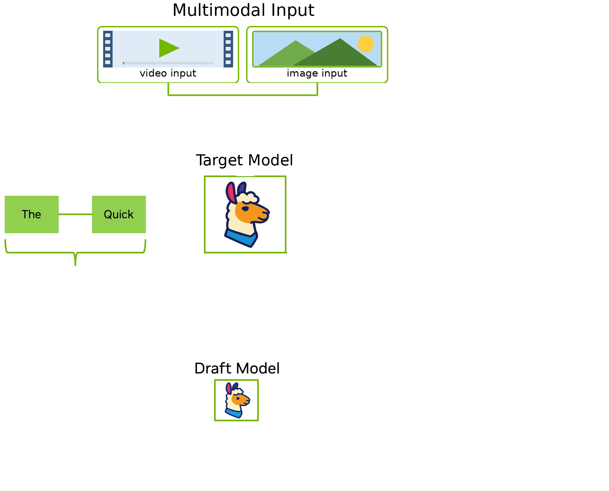
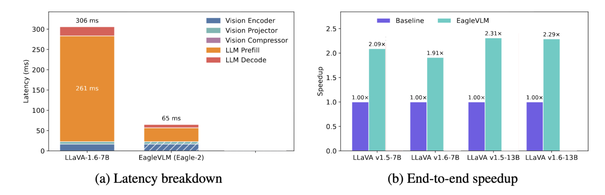
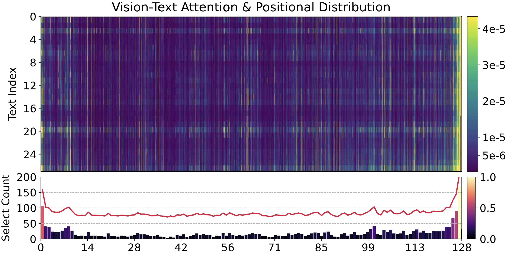
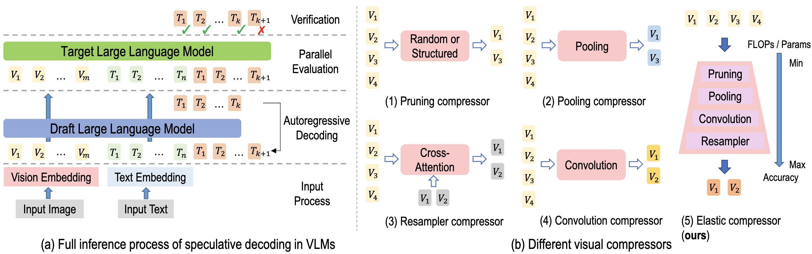
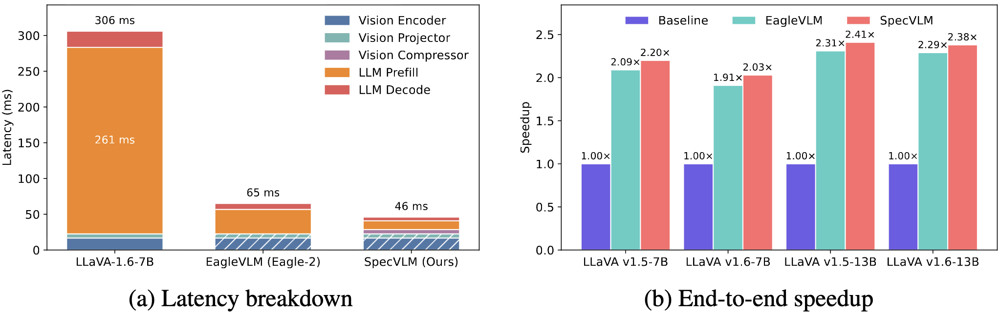

##### <b>Matteo Nulli</b>
<!-- ###### eBay
######  &nbsp;  -->

<!-- <a href="https://huggingface.co/blog/MatteoNulli/de-mystifying-multimodal-learning-speculative-decoding" title="Community Article"><i class="fa-brands fa-hugging-face" style="font-size: 1.75em;"></i></a>  -->
<a href="https://matteonulli.github.io/blog/2026/demystifying_sd_multimodal/" title="Blogpost"><i class="fa-regular fa-newspaper" style="font-size: 1.75em;"></i></a>
<br>

## Introduction

Across the previous blog posts of `Demystifying Multimodal Learning`, we have built a clear mental model of the cost of vision. We defined  <abbr title="Click here for our previous blogpost.">[what a Visual Token (VT) is](https://huggingface.co/blog/MatteoNulli/de-mystifying-multimodal-learning-enabiling-vision)</abbr>, derived formulas to  <abbr title="Click here for our previous blogpost.">[calculate # Visual Tokens ( \\( V \\)) across architectures](https://huggingface.co/blog/MatteoNulli/de-mystifying-multimodal-learning-hidden-ineff)</abbr>, and dissected their  <abbr title="Click here for our previous blogpost.">[impact on inference latency, context windows and VRAM](https://huggingface.co/blog/MatteoNulli/de-mystifying-multimodal-learning-impact-vt-laten)</abbr>.

So far, every lever we pulled was about *spending fewer tokens*. But there is an orthogonal question, one that lives at the very end of the pipeline, in the autoregressive decoding loop:

<p align="center"><code>Can we make a VLMs generate faster, without retraining it and without changing a single output token?</code></p>

The text-only world answered this years ago with **Speculative Decoding (SD)** ([Leviathan et al., 2023](#specdec-2023), [Chen et al., 2023](#specsample-2023)): a *lossless* trick that routinely doubles LLM throughput. The natural follow-up is whether this free lunch survives the jump to images and video. As we will see, the answer is a qualified *yes*, the naive recipe already works, but the visual tokens we have spent three blogposts worrying about come back to haunt us, and squeezing out the full speedup requires rethinking SD with vision in mind.

In this installment we will first recap [how Speculative Decoding works](#speculative-decoding-in-a-nutshell), then ask [whether it applies natively to VLMs](#can-we-apply-speculative-decoding-natively-to-vlms) and what breaks, and finally walk through the fixes [issue by issue](#fixing-issue-by-issue), from compressing the draft's visual load to keeping it aligned, de-biasing its pruning, and parallelizing its schedule, across the fast-growing landscape of multimodal SD.

## Speculative Decoding in a Nutshell

Autoregressive generation is slow for a structural reason: each token requires a full forward pass of a large model, and these passes are *memory-bound*. The GPU spends most of its time shuffling weights and KV Cache in and out of memory, not computing. Decoding one token uses roughly the same wall-clock time as decoding many in parallel.

Speculative Decoding exploits exactly this asymmetry with two models:

- A small, fast **draft** model \\( q \\) that autoregressively proposes a chunk of \\( k \\) candidate tokens.
- A large, accurate **target** model \\( p \\) that verifies all \\( k \\) candidates in a **single parallel forward pass**.

<a id="figure-1"></a>
<figure style="width: 80%; margin: auto; text-align: center;">
  
  <figcaption style="margin-top: 10px; font-style: italic; color: #555;">
    Figure 1: <b>The two phases of Speculative Decoding.</b> Step 1: the draft model cheaply autoregresses a chunk of tokens. Step 2: the target model verifies the whole chunk in one parallel pass, accepting the longest correct prefix and rejecting the rest. Video from <a href="https://developer.nvidia.com/blog/an-introduction-to-speculative-decoding-for-reducing-latency-in-ai-inference/">NVIDIA Developer blog</a>.
  </figcaption>
</figure>


The magic is in the verification step. Rather than blindly trusting the draft, SD applies **rejection sampling**: each drafted token \\( x \\) is accepted with probability

$$ \alpha(x) = \min\left(1, \frac{p(x)}{q(x)}\right) $$

and on the first rejection, the token is resampled from the residual distribution \\( (p - q)_+ \\) (renormalized). This rule is not a heuristic, it is provably equivalent to sampling directly from the target \\( p \\) ([Leviathan et al., 2023](#specdec-2023)). In other words, SD is **lossless**: the output distribution is *identical* to running the target model alone. We pay nothing in quality, we only gain speed, exactly as long as the cheap draft tends to agree with the expensive target.

A short worked example from [Figure 1](#figure-1) (<a href="https://developer.nvidia.com/blog/an-introduction-to-speculative-decoding-for-reducing-latency-in-ai-inference/">NVIDIA Developer blog</a>): suppose the input sequence is *"The Quick"* and seeing this the draft proposes *"Brown Fox Hopped Over"*. The target verifies in parallel and, comparing \\( p(x) \\) against \\( q(x) \\) token by token, it accepts *"Brown"*, *" Fox"*, but rejects *"Hopped"* (because \\( p(\text{Hopped}) \ll q(\text{Hopped}) \\)). We keep the 2 accepted tokens, resample the third from the target obtaining *"Jumped"*, and start the next round, all for the price of **one** target forward pass instead of three.

Two metrics govern how much we actually win, and we will see both throughout the rest of this post:

- **Wall-clock speedup:** end-to-end latency relative to the autoregressive target baseline, reported as a "×" factor. This is the number that pays the bills.
- **Mean accepted length ( \\( \sigma \\) ):** the average number of tokens accepted by the target per speculative round. Higher \\( \sigma \\) means the draft is better aligned with the target, the lever that drives the speedup.

The whole game of *good* speculative decoding is maximizing \\( \sigma \\) (a well-aligned, fast draft) while keeping the draft itself cheap. Modern LLM methods such as Medusa ([Cai et al., 2024](#medusa-2024)) and the EAGLE family ([Li et al., 2024](#eagle-2024), [2024b](#eagle2-2024), [2025](#eagle3-2025)) push \\( \sigma \\) up by drafting at the *feature* level and reusing the target's own LM head, rather than training a fully separate small model.

## Can We Apply Speculative Decoding Natively to VLMs?

The honest first question is whether any of this even matters for multimodal models, or whether you can just bolt a standard EAGLE-style draft onto a VLM and call it a day.

<p align="center"><code>Does Speculative Decoding provide speed advantages when applied naively to VLMs?</code></p>

The answer is a clear **yes**. 


<a id="figure-2"></a>
<figure style="width: 80%; margin: auto; text-align: center;">
  
  <figcaption style="margin-top: 10px; font-style: italic; color: #555;">
    Figure 2: <b>Naive SD extends to VLMs by sharing the multimodal embedding.</b> The image and video inputs are encoded once and the resulting multimodal embedding is fed to <i>both</i> the draft and the target model, on top of the text prefix. The process is then the same as <a href="#figure-1">Figure 1</a>. Adapted from the <a href="https://developer.nvidia.com/blog/an-introduction-to-speculative-decoding-for-reducing-latency-in-ai-inference/">NVIDIA Developer blog</a>.
  </figcaption>
</figure>


Building a faithful EAGLE-2-style draft for a VLM, what the SpecVLM ([Huang et al., 2025](#specvlm-2025)) authors call *EagleVLM*, already delivers **1.5–2.3× end-to-end speedups** over full autoregressive inference across the LLaVA family, with no loss in output quality. The reason is intuitive: as we established in our [latency blogpost](https://huggingface.co/blog/MatteoNulli/de-mystifying-multimodal-learning-impact-vt-laten), VLM decoding is just as memory-bound as LLM decoding, so the same asymmetry SD exploits is still there.

<a id="figure-3"></a>
<figure style="width: 80%; margin: auto; text-align: center;">
  
  <figcaption style="margin-top: 10px; font-style: italic; color: #555;">
    Figure 3: <b>Naive SD already helps.</b> EagleVLM yields 1.9–2.3× speedups across LLaVA v1.5/v1.6 at 7B and 13B. Figure adapted from <a href="#specvlm-2025">(Huang et al., 2025)</a>.
  </figcaption>
</figure>

The trouble starts when we ask *why it isn't even faster*, and here the visual tokens we have been tracking all series long take center stage.

#### The image problem

Several issues hold naive SD back on VLMs. Two coupled ones form the core ([Huang et al., 2025](#specvlm-2025)):

1. **Visual tokens inflate the KV Cache.** Multi-image and high-resolution inputs dump thousands of visual tokens into the cache during prefill (recall the [AnyRes / multi-grid blowup](https://huggingface.co/blog/MatteoNulli/de-mystifying-multimodal-learning-hidden-ineff#:~:text=Strategy%20B%3A%20The%20Multi%2DGrid%20/%20AnyRes)). The draft model inherits this burden: it must carry the same enormous visual context, which makes the "cheap" draft far less cheap.
2. **A fat KV Cache means slow attention.** A larger cache raises per-step latency, particularly in the attention layers and the memory traffic moving keys and values around. Every extra visual token the draft drags along directly erodes the speed advantage it is supposed to provide.

The takeaway is that, in the multimodal setting, the draft's *visual* workload, not its language modeling, becomes the bottleneck. This is the single observation that motivates **vision token compression** as the central design lever for multimodal SD.

<!-- CLAUDE: draft bullets below surface problems raised in the referenced papers that were not previously named in this section. Review, edit, or delete. -->
But volume is not the only issue the literature raises. A few more problems compound it:

3. **[draft — review]** *Text and visual tokens are fundamentally different.* <!-- CLAUDE: from MSD (Lin et al., 2025) --> Pushing both through a single, undifferentiated draft pathway is suboptimal, the draft needs *both* strong language modeling and genuine visual perception, and training naively on multimodal data can erode one while trying to build the other ([Lin et al., 2025](#msd-2025)).
4. **[draft — review]** *Visual grounding decays over long generations.* <!-- CLAUDE: from ViSpec (Kang et al., 2025) --> A large VLM filters redundant image information layer by layer, but a small draft struggles to, so the further it generates, the more it drifts from the image and the shorter the accepted length becomes ([Kang et al., 2025](#vispec-2025)).
5. **[draft — review]** *Keeping a compressed draft aligned is expensive.* <!-- CLAUDE: from SpecVLM-image (Huang et al., 2025) --> The usual alignment fix, offline distillation, requires building and storing a teacher-logit corpus at multimodal scale, which is cumbersome and storage-heavy ([Huang et al., 2025](#specvlm-2025)).
6. **[draft — review]** *Training data is scarce.* <!-- CLAUDE: from ViSpec (Kang et al., 2025) --> There are few multimodal datasets with long assistant responses, exactly the regime a draft must be trained on to stay grounded over long outputs ([Kang et al., 2025](#vispec-2025)).

#### The video problem

Video LLMs make everything worse, because the token counts are larger by another order of magnitude. Beyond the image issues above, three additional pain points emerge ([Kong et al., 2026](#parallelvlm-2026)):

1. **Sequential execution bottleneck.** In vanilla SD the draft and target run one after the other. As video tokens grow, both prefilling latency and decoding time grow with them, and because of this sequential scheduling the hardware sits idle for roughly **20% of the prefill** span and **50% of the decode** span. The accelerators are starved precisely when there is the most work to do.
2. **Entanglement of speed ratio and alignment.** Heavier video inputs shrink the draft's relative speed advantage, the obvious fix is to *prune* the draft's visual tokens, but a draft running on aggressively pruned windows can no longer retain salient visual detail or coherent textual grounding. Pruning buys speed and pays for it in acceptance length. SpecVLM partially mitigates this through online distillation (more below), but the tension remains.
3. **Positional bias in attention guidance.** A tempting way to choose *which* tokens to keep is to follow the target's attention. Some papers [<a href="#parallelvlm-2026">Kong et al., 2026</a>] show the target's attention over video is strongly position-biased: in one analysis (<a href="#figure-4">Figure 4</a>), **21% of the selected video tokens fall within just 4.0% of the position width** (the first frame and the last few, frames 1 and 125–128). Pruning by raw attention therefore keeps tokens because of *where* they are, not because of *what* they carry, a biased and lossy signal.

<a id="figure-4"></a>
<figure style="width: 75%; margin: auto; text-align: center;">
  
  <figcaption style="margin-top: 10px; font-style: italic; color: #555;">
    Figure 4: <b>Attention is positionally biased.</b> The target model disproportionately selects video tokens at the start and end of the sequence, regardless of content. Figure adapted from <a href="#parallelvlm-2026">Kong et al., 2026</a>.
  </figcaption>
</figure>

<!-- CLAUDE: draft bridge bullet, surfaces the action-modality problem raised by Spec-VLA (Wang et al., 2025). Review, edit, or delete. -->
**[draft — review]** And a fourth problem appears once we leave perception for *action*. <!-- CLAUDE: from Spec-VLA (Wang et al., 2025) --> Vision-Language-Action models emit structured, continuous-valued action tokens, and SD's strict *exact-match* acceptance criterion collapses the accepted length on them, applying a standard SD framework directly barely moves the needle ([Wang et al., 2025](#specvla-2025)). The rigidity of the acceptance rule, not the token count, is what breaks here.

In the section below we walk through the concrete answers the field has proposed, organized by the problem each one attacks rather than paper by paper.

## Fixing Multimodal Speculative Decoding, Issue by Issue {#fixing-issue-by-issue}

Every problem above has by now attracted at least one answer. Rather than march through the literature paper by paper, this section is organized around the *issues*: for each one, we look at how one or more works attack it. The recurring recipe underneath all of them is the same, *lighten the draft's visual load, keep it aligned with the target, and never break losslessness*, but the specific lever differs from problem to problem. A single paper can therefore show up in more than one place.

**Naming warning:** two of the works below are both called **SpecVLM** ([Huang et al., 2025](#specvlm-2025), [Ji et al., 2025](#specvlm-video-2025)). They came out concurrently from different groups and attack the problem from different ends, images and video. We disambiguate by modality throughout.

### Shrinking the draft's visual load {#specvlm-image}

*The core issue: the draft inherits thousands of visual tokens, which bloat its KV Cache and slow its attention.* The obvious move is to compress those tokens before they ever reach the draft, and three works do exactly that, each differently.

**SpecVLM (image)** ([Huang et al., 2025](#specvlm-2025)) refuses to commit to a single compressor, because the *right* one depends on the input: a dense OCR image and a simple scene have very different compression sweet spots. It assembles a toolbox of four complementary visual compressors, pruning, pooling, convolution and resampler primitives, and combines them into a single **elastic** compressor that adaptively selects how aggressively to compress per input, navigating the FLOPs/parameters-versus-accuracy frontier on the fly (<a href="#figure-5">Figure 5</a>).

<a id="figure-5"></a>
<figure style="width: 85%; margin: auto; text-align: center;">
  
  <figcaption style="margin-top: 10px; font-style: italic; color: #555;">
    Figure 5: <b>The visual compressor toolbox.</b> Pruning, pooling, convolution and resampler primitives, combined into an elastic compressor that trades FLOPs/parameters against accuracy per input. Figure adapted from <a href="#specvlm-2025">(Huang et al., 2025)</a>.
  </figcaption>
</figure>

<u>Upside</u>: **the draft carries a fraction of the visual tokens, so each draft step gets genuinely cheaper**.<br>
<u>Downside</u>: a more aggressively compressed draft sees less, and risks drifting from the target, which is exactly what [keeping the draft aligned](#keeping-the-slimmed-draft-aligned) has to repair.

**SpecVLM (video)** ([Ji et al., 2025](#specvlm-video-2025)) attacks the same load in the far worse video regime, where a handful of frames balloons into thousands of tokens. Its starting point is a surprising empirical finding: **the draft's speculation is remarkably insensitive to how aggressively you prune the video tokens it sees**, you can throw away up to **90%** of them and the mean accepted length \\( \sigma \\) barely budges. Better still, it is **training-free**, no distillation and no fine-tuning, it works at inference time on off-the-shelf draft/target pairs. The pruning is two-stage:

- **Stage I, verifier-guided selection.** The target model, the "verifier" that already runs every round, exposes attention signals that flag which video tokens are genuinely informative; SpecVLM keeps those.
- **Stage II, spatially-uniform pruning.** Among the survivors, the remaining redundancy is trimmed uniformly across space, so coverage stays even across the frame instead of clustering. (This second stage is also what counters [attention's positional bias](#de-biasing-attention-guided-pruning).)

The draft then speculates over this heavily-pruned set while the target still verifies against the full sequence, so losslessness is never in question.

<!-- PLACEHOLDER IMAGE — upload the SpecVLM (Ji et al., 2025) Figure 1 (draft latency breakdown + accept length vs Std.-SD) to your HF CDN and replace the src. -->
<a id="figure-7"></a>
<figure style="width: 85%; margin: auto; text-align: center;">
  
  <figcaption style="margin-top: 10px; font-style: italic; color: #555;">
    Figure 7: <b>SpecVLM's draft cost and accept length.</b> (a) Draft latency breakdown for LLaVA-OneVision-7B, decoding time averaged over 100 tokens on a single NVIDIA A100. (b) Average accept length compared with standard SD (Std.-SD). Figure adapted from <a href="#specvlm-video-2025">Ji et al., 2025</a>.
  </figcaption>
</figure>

The two panels of [Figure 7](#figure-7) tell the story: aggressively pruning the draft's video tokens slashes its per-token latency (a), while \\( \sigma \\) holds up against standard SD (b), cheaper draft steps with no loss in how much the target accepts. Averaged across four video understanding benchmarks this compounds into up to **2.68×** decoding speedup on LLaVA-OneVision-72B and **2.11×** on Qwen2.5-VL-32B, all strictly lossless.

**ViSpec** ([Kang et al., 2025](#vispec-2025)) compresses at the architecture level instead, adding a lightweight Q-Former-style vision adaptor that shrinks the image tokens the draft has to carry (its second, complementary idea, persistent grounding, is covered [below](#preserving-visual-grounding-over-long-generations)).

### Keeping the slimmed draft aligned {#keeping-the-slimmed-draft-aligned}

*The core issue: a compressed draft sees less, so it risks drifting from the target, and if acceptance length \\( \sigma \\) collapses the speedup evaporates.* The usual fix, offline distillation, means building and storing a teacher-logit corpus at multimodal scale, which is cumbersome and storage-heavy.

**SpecVLM (image)** ([Huang et al., 2025](#specvlm-2025)) sidesteps that corpus by distilling **online**, generating the teacher's supervision on the fly during training.

<!-- :

- The target produces token-level logits \\( \mathbf{z}_p \\) and penultimate-layer features \\( \mathbf{f}_p \\).
- The draft produces its own \\( \mathbf{z}_q \\) and \\( \mathbf{f}_q \\).
- The draft is trained to match both, with a combined cross-entropy (on logits) and Smooth-L1 (on features) objective:

$$ \mathcal{L}_{\text{online}} = \lambda_{\text{logit}}\, \mathcal{L}_{\text{CE}}(\mathbf{z}_q, \mathbf{z}_p) + \lambda_{\text{feat}}\, \mathcal{L}_{\text{SmoothL1}}(\mathbf{f}_q, \mathbf{f}_p) $$ -->

This eliminates the offline corpus entirely while staying compute-efficient. It also surfaces a neat empirical phenomenon, a **training-time scaling effect**: with the data and draft architecture fixed, *longer* online training monotonically *increases* \\( \sigma \\), and hence the speedup. Better-aligned drafts are, quite literally, a matter of training them longer.

<a id="figure-6"></a>
<figure style="width: 85%; margin: auto; text-align: center;">
  
  <figcaption style="margin-top: 10px; font-style: italic; color: #555;">
    Figure 6: <b>SpecVLM's latency and speedup.</b> (a) Per-image latency breakdown for LLaVA-1.6-7B: the 306 ms autoregressive pass, dominated by a 261 ms LLM prefill, drops to 65 ms with EagleVLM and to 46 ms with SpecVLM. (b) End-to-end speedups across the LLaVA v1.5/v1.6 family at 7B and 13B, where SpecVLM edges past the EagleVLM baseline on every model. Figure adapted from <a href="#specvlm-2025">(Huang et al., 2025)</a>.
  </figcaption>
</figure>

Stacking compression and online distillation on top of EagleVLM edges the latency improvement past the baseline on every LLaVA model ([Figure 6b](#figure-6)): 2.09× → 2.20× on v1.5-7B, up to 2.31× → **2.41×** on v1.5-13B. The latency story is the more striking one ([Figure 6a](#figure-6)): the 306 ms autoregressive pass for LLaVA-1.6-7B collapses to **46 ms**, with the once-dominant 261 ms prefill all but gone, and all of it stays strictly lossless.

### Handling text and visual tokens differently {#handling-text-and-visual-tokens-differently}

*The core issue: text and visual tokens are fundamentally different, so forcing both through one undifferentiated draft pathway is suboptimal.*

**MSD — Multimodal Speculative Decoding** ([Lin et al., 2025](#msd-2025)) argues the draft should process the two token types *separately*, and trains it in two stages to build both capabilities without one eroding the other: text-only instruction tuning first, then a gradual curriculum of multimodal data. It reaches up to 2.29×/2.46× on LLaVA-1.5 7B/13B.

### Preserving visual grounding over long generations {#preserving-visual-grounding-over-long-generations}

*The core issue: a small draft cannot filter visual redundancy layer by layer the way a large VLM does, so it loses touch with the image as the response grows longer.*

**ViSpec** ([Kang et al., 2025](#vispec-2025)) extracts a single *global* visual feature vector and injects it into every subsequent text token's hidden state, giving the draft persistent visual grounding over long generations. To train for exactly this regime it also builds synthetic long-response data, directly addressing the scarcity of multimodal datasets with long assistant responses. It reports up to **3.22×**, against ~1.6× for Medusa and ~2.1× for EAGLE-2 on the same models.

### De-biasing attention-guided pruning {#de-biasing-attention-guided-pruning}

*The core issue: choosing which tokens to keep by the target's raw attention is positionally biased, it keeps tokens for* where *they sit, not* what *they carry.*

**SpecVLM (video)**'s Stage II ([Ji et al., 2025](#specvlm-video-2025)) is a first mitigation: after the attention-guided selection, it prunes the survivors *spatially uniformly*, so coverage does not clump.

**ParallelVLM** ([Kong et al., 2026](#parallelvlm-2026)) removes the biased signal entirely with **UV-Prune**: instead of trusting raw attention, it keeps the tokens whose vision-text alignment *grows* as they move deeper through the target's layers, an attention-free, unbiased criterion (also compatible with FlashAttention-style kernels). Against lossy pruning such as FastV ([Chen et al., 2024](#fastv-2024)), SparseVLM ([Zhang et al., 2024](#sparsevlm-2024)) and DyCoke ([Tao et al., 2024](#dycoke-2024)) it holds ~98–99% accuracy where those sit at ~83–91%.

### Breaking the sequential bottleneck {#breaking-the-sequential-bottleneck}

*The core issue: in vanilla SD the draft and target run one after the other, so on heavy video inputs the hardware sits idle for much of prefill and decode.*

**ParallelVLM** ([Kong et al., 2026](#parallelvlm-2026)) reorganizes the schedule into a **parallel pipeline**: it overlaps draft and target prefill, spends the leftover slack generating *startup tokens* before decoding begins, and lets draft generation and target verification proceed in overlapping windows, widening the verification window by nearly 2×. Combined with UV-Prune above and still fully lossless, it reaches up to **3.36×** on LLaVA-OV (7B & 72B). <!-- CLAUDE: the paper's abstract (arXiv:2603.19610) headlines "up to 2.11×". Reconcile 3.36× against the paper body before publishing. -->

### Relaxing acceptance for action tokens {#relaxing-acceptance-for-action-tokens}

*The core issue: SD's strict exact-match acceptance criterion collapses the accepted length on structured, continuous-valued action tokens.*

**Spec-VLA** ([Wang et al., 2025](#specvla-2025)) pushes SD beyond perception into *action*: for Vision-Language-Action robotics models, it relaxes the acceptance criterion using the relative distances between action tokens, recovering a 1.42× speedup over OpenVLA where naive SD barely moves the needle.

### A snapshot of the landscape

<div style="margin-top: 2rem; margin-bottom: 2rem; font-family: sans-serif; width: 100%;">
    <table style="margin-left: auto; margin-right: auto; border-collapse: collapse; border: 1px solid #dee2e6; box-shadow: 0 2px 5px rgba(0,0,0,0.05); min-width: 60%;">
        <thead>
            <tr style="background-color: #f8f9fa; border-bottom: 2px solid #dee2e6;">
                <th style="padding: 12px 20px; text-align: left; border: 1px solid #dee2e6;">Method</th>
                <th style="padding: 12px 20px; text-align: left; border: 1px solid #dee2e6;">Modality</th>
                <th style="padding: 12px 20px; text-align: left; border: 1px solid #dee2e6;">Core Idea</th>
                <th style="padding: 12px 20px; text-align: center; border: 1px solid #dee2e6;">Reported Speedup</th>
            </tr>
        </thead>
        <tbody>
            <tr style="border-bottom: 1px solid #dee2e6; background-color: #eaf2fb; color: #212529;">
                <td style="padding: 12px 20px; border: 1px solid #dee2e6; font-weight: bold;">EagleVLM<br><span style="font-weight: normal; font-size: 0.85em; color: #555;"><a href="#specvlm-2025">(Huang et al., 2025)</a></span></td>
                <td style="padding: 12px 20px; border: 1px solid #dee2e6;">Image</td>
                <td style="padding: 12px 20px; border: 1px solid #dee2e6;">EAGLE-2 draft ported to VLMs</td>
                <td style="padding: 12px 20px; border: 1px solid #dee2e6; text-align: center;">1.5–2.3×</td>
            </tr>
            <tr style="border-bottom: 1px solid #dee2e6; background-color: #eaf2fb; color: #212529;">
                <td style="padding: 12px 20px; border: 1px solid #dee2e6; font-weight: bold;">SpecVLM<br><span style="font-weight: normal; font-size: 0.85em; color: #555;"><a href="#specvlm-2025">(Huang et al., 2025)</a></span></td>
                <td style="padding: 12px 20px; border: 1px solid #dee2e6;">Image</td>
                <td style="padding: 12px 20px; border: 1px solid #dee2e6;">Elastic visual compressor + online-logit distillation</td>
                <td style="padding: 12px 20px; border: 1px solid #dee2e6; text-align: center;">2.5–2.9×</td>
            </tr>
            <tr style="border-bottom: 1px solid #dee2e6; background-color: #eaf2fb; color: #212529;">
                <td style="padding: 12px 20px; border: 1px solid #dee2e6; font-weight: bold;">MSD<br><span style="font-weight: normal; font-size: 0.85em; color: #555;"><a href="#msd-2025">(Lin et al., 2025)</a></span></td>
                <td style="padding: 12px 20px; border: 1px solid #dee2e6;">Image</td>
                <td style="padding: 12px 20px; border: 1px solid #dee2e6;">Separate text/visual drafting + staged training</td>
                <td style="padding: 12px 20px; border: 1px solid #dee2e6; text-align: center;">~2.3–2.5×</td>
            </tr>
            <tr style="border-bottom: 1px solid #dee2e6; background-color: #eaf2fb; color: #212529;">
                <td style="padding: 12px 20px; border: 1px solid #dee2e6; font-weight: bold;">ViSpec<br><span style="font-weight: normal; font-size: 0.85em; color: #555;"><a href="#vispec-2025">(Kang et al., 2025)</a></span></td>
                <td style="padding: 12px 20px; border: 1px solid #dee2e6;">Image</td>
                <td style="padding: 12px 20px; border: 1px solid #dee2e6;">Vision adaptor + global feature injection</td>
                <td style="padding: 12px 20px; border: 1px solid #dee2e6; text-align: center;">up to 3.22×</td>
            </tr>
            <tr style="border-bottom: 1px solid #dee2e6; background-color: #f0eafb; color: #212529;">
                <td style="padding: 12px 20px; border: 1px solid #dee2e6; font-weight: bold;">Video SpecVLM<br><span style="font-weight: normal; font-size: 0.85em; color: #555;"><a href="#specvlm-video-2025">(Ji et al., 2025)</a></span></td>
                <td style="padding: 12px 20px; border: 1px solid #dee2e6;">Video</td>
                <td style="padding: 12px 20px; border: 1px solid #dee2e6;">Training-free staged verifier-guided pruning (≤90%)</td>
                <td style="padding: 12px 20px; border: 1px solid #dee2e6; text-align: center;">up to 2.68×</td>
            </tr>
            <tr style="border-bottom: 1px solid #dee2e6; background-color: #f0eafb; color: #212529;">
                <td style="padding: 12px 20px; border: 1px solid #dee2e6; font-weight: bold;">ParallelVLM<br><span style="font-weight: normal; font-size: 0.85em; color: #555;"><a href="#parallelvlm-2026">(Kong et al., 2026)</a></span></td>
                <td style="padding: 12px 20px; border: 1px solid #dee2e6;">Video</td>
                <td style="padding: 12px 20px; border: 1px solid #dee2e6;">UV-Prune + parallel prefill + startup tokens</td>
                <td style="padding: 12px 20px; border: 1px solid #dee2e6; text-align: center;">up to 3.36×</td>
            </tr>
            <tr style="border-bottom: 1px solid #dee2e6; background-color: #fbf3ea; color: #212529;">
                <td style="padding: 12px 20px; border: 1px solid #dee2e6; font-weight: bold;">Spec-VLA<br><span style="font-weight: normal; font-size: 0.85em; color: #555;"><a href="#specvla-2025">(Wang et al., 2025)</a></span></td>
                <td style="padding: 12px 20px; border: 1px solid #dee2e6;">Action (VLA)</td>
                <td style="padding: 12px 20px; border: 1px solid #dee2e6;">Relaxed acceptance on action-token distances</td>
                <td style="padding: 12px 20px; border: 1px solid #dee2e6; text-align: center;">1.42×</td>
            </tr>
        </tbody>
    </table>
    <p style="text-align: center; margin-top: 15px; font-size: 0.9em; color: #555; font-style: italic;">
        Table 1: <b>A snapshot of Speculative Decoding for multimodal architectures.</b> Speedups are reported by each respective paper and are not directly comparable across different models, hardware and settings.
    </p>
</div>

## Conclusions & Key Takeaways

So, where are the *accuracy* tables in all of this? The answer is the quiet superpower of this whole line of work: there aren't any to report, and that is the point. Every method here lives inside a rejection-sampling framework that provably reproduces the target's output distribution. The decoding is **lossless** by construction, so the only meaningful axis is speed.

Pulling the threads together:

- *Speculative Decoding works on multimodal models out of the box.* A naive EAGLE-style draft already buys roughly 2× on VLMs, for free and without quality loss, which is a strong argument for reaching for it in production.
- *Visual tokens are still the villain.* The very token counts we spent this series quantifying are what cap the naive speedup: they bloat the draft's KV Cache, slow its attention, and, in video, starve the hardware through sequential scheduling.
- *The fix is to lighten and align the draft.* Whether through SpecVLM's elastic compression and online distillation, ParallelVLM's unbiased UV-Prune and parallel pipeline, or ViSpec's global feature injection, the recipe is the same: give the draft fewer visual tokens, but keep it faithful to the target so acceptance length stays high.

And the road ahead is wide open. A few questions I find particularly exciting:

- Can these techniques extend to **self-speculative** decoding, where one model drafts and verifies itself, removing the separate draft entirely?
- Can we dynamically **compress the draft's KV Cache** rather than only its input token window?
- Beyond pruning the *tokens*, why not prune the *model*, drafting with a structurally smaller target?
- And, as always, how far does **scaling the training and data** of the draft push the mean accepted length \\( \sigma \\)?

Multimodal inference is expensive, but it does not have to be slow. Speculative Decoding is one of the rare optimizations that costs us nothing in quality, and as the draft learns to see with fewer, smarter tokens, the gap between "watching a model think" and "getting the answer" keeps closing.

## Citation

If you use this work, please cite:

```bibtex
@misc{nulli2026speculativedecoding,
  title={Demystifying Multimodal Learning: Speculative Decoding in Multimodal Architectures},
  author={Nulli, Matteo},
  year={2026},
  url={https://matteonulli.github.io/blog/2026/demystifying_sd_multimodal/},
  note={BlogPost},
}
```


<br>

**References**

<div id="references-section">

<a id="specdec-2023" class="bib-item"> Leviathan, Yaniv, Matan Kalman, and Yossi Matias. "Fast inference from transformers via speculative decoding." International Conference on Machine Learning (ICML), 2023. arXiv preprint arXiv:2211.17192. </a>

<a id="specsample-2023" class="bib-item"> Chen, Charlie, Sebastian Borgeaud, Geoffrey Irving, Jean-Baptiste Lespiau, Laurent Sifre, and John Jumper. "Accelerating large language model decoding with speculative sampling." arXiv preprint arXiv:2302.01318 (2023). </a>

<a id="medusa-2024" class="bib-item"> Cai, Tianle, Yuhong Li, Zhengyang Geng, Hongwu Peng, Jason D. Lee, Deming Chen, and Tri Dao. "Medusa: Simple LLM inference acceleration framework with multiple decoding heads." International Conference on Machine Learning (ICML), 2024. arXiv preprint arXiv:2401.10774. </a>

<a id="eagle-2024" class="bib-item"> Li, Yuhui, Fangyun Wei, Chao Zhang, and Hongyang Zhang. "EAGLE: Speculative sampling requires rethinking feature uncertainty." International Conference on Machine Learning (ICML), 2024. arXiv preprint arXiv:2401.15077. </a>

<a id="eagle2-2024" class="bib-item"> Li, Yuhui, Fangyun Wei, Chao Zhang, and Hongyang Zhang. "EAGLE-2: Faster inference of language models with dynamic draft trees." Conference on Empirical Methods in Natural Language Processing (EMNLP), 2024. arXiv preprint arXiv:2406.16858. </a>

<a id="eagle3-2025" class="bib-item"> Li, Yuhui, Fangyun Wei, Chao Zhang, and Hongyang Zhang. "EAGLE-3: Scaling up inference acceleration of large language models via training-time test." arXiv preprint arXiv:2503.01840 (2025). </a>

<a id="specvlm-2025" class="bib-item"> Huang, Haiduo, Fuwei Yang, Zhenhua Liu, Xuanwu Yin, Dong Li, Pengju Ren, and Emad Barsoum. "SpecVLM: Fast speculative decoding in vision-language models." arXiv preprint arXiv:2509.11815 (2025). </a>

<a id="parallelvlm-2026" class="bib-item"> Kong, Quan, Yuhao Shen, Yicheng Ji, Huan Li, and Cong Wang. "ParallelVLM: Lossless video-LLM acceleration with visual alignment aware parallel speculative decoding." Proceedings of the IEEE/CVF Conference on Computer Vision and Pattern Recognition (CVPR), 2026. </a>

<a id="specvlm-video-2025" class="bib-item"> Ji, Yicheng, Jun Zhang, Heming Xia, Jinpeng Chen, Lidan Shou, Gang Chen, and Huan Li. "SpecVLM: Enhancing speculative decoding of video LLMs via verifier-guided token pruning." Conference on Empirical Methods in Natural Language Processing (EMNLP), 2025. arXiv preprint arXiv:2508.16201. </a>

<a id="msd-2025" class="bib-item"> Lin, Luxi, Zhihang Lin, Zhanpeng Zeng, and Rongrong Ji. "Speculative decoding reimagined for multimodal large language models." arXiv preprint arXiv:2505.14260 (2025). </a>

<a id="vispec-2025" class="bib-item"> Kang, Jialiang, Han Shu, Wenshuo Li, Yingjie Zhai, and Xinghao Chen. "ViSpec: Accelerating vision-language models with vision-aware speculative decoding." arXiv preprint arXiv:2509.15235 (2025). </a>

<a id="specvla-2025" class="bib-item"> Wang, Songsheng, Rucheng Yu, Zhihang Yuan, Chao Yu, Feng Gao, Yu Wang, and Derek F. Wong. "Spec-VLA: Speculative decoding for vision-language-action models with relaxed acceptance." Conference on Empirical Methods in Natural Language Processing (EMNLP), 2025. arXiv preprint arXiv:2507.22424. </a>

<a id="fastv-2024" class="bib-item"> Chen, Liang, Haozhe Zhao, Tianyu Liu, Shuai Bai, Junyang Lin, Chang Zhou, and Baobao Chang. "An image is worth 1/2 tokens after layer 2: Plug-and-play inference acceleration for large vision-language models." European Conference on Computer Vision (ECCV), 2024. arXiv preprint arXiv:2403.06764. </a>

<a id="sparsevlm-2024" class="bib-item"> Zhang, Yuan, Chun-Kai Fan, Junpeng Ma, Wenzhao Zheng, Tao Huang, Kuan Cheng, Denis Gudovskiy, Tomoyuki Okuno, Yohei Nakata, Kurt Keutzer, and Shanghang Zhang. "SparseVLM: Visual token sparsification for efficient vision-language model inference." arXiv preprint arXiv:2410.04417 (2024). </a>

<a id="dycoke-2024" class="bib-item"> Tao, Keda, Can Qin, Haoxuan You, Yang Sui, and Huan Wang. "DyCoke: Dynamic compression of tokens for fast video large language models." arXiv preprint arXiv:2411.15024 (2024). </a>

<a id="llavonevision-2024" class="bib-item">Bo Li, Yuanhan Zhang, Dong Guo, Renrui Zhang, Feng Li, Hao Zhang, Kaichen Zhang, Peiyuan Zhang, Yanwei Li, Ziwei Liu, and Chunyuan Li. 2024a. Llava-onevision: Easy visual task transfer. Preprint, arXiv:2408.03326.</a>

<a id="qwen2-5-vl-2025" class="bib-item">Bai Shuai, Chen Keqin, Liu Xuejing, Wang Jialin, Ge Wenbin, Song Sibo, Dang Kai, Wang Peng, Wang Shijie, Tang Jun, Zhong Humen, Zhu Yuanzhi, Yang Mingkun, Li Zhaohai, Wan Jianqiang, Wang Pengfei, Ding Wei, Fu Zheren, Xu Yiheng, Ye Jiabo, Zhang Xi, Xie Tianbao, Cheng Zesen, Zhang Hang, Yang Zhibo, Xu Haiyang, Lin Junyang. (2025). Qwen2.5-VL Technical Report. arXiv preprint arXiv:2502.13923.</a>

</div>

<style>
  /* Hide all references by default */
  .bib-item { display: none; }
  /* Show only the ones with the 'cited' class */
  .bib-item.cited { display: block; margin-bottom: 10px; }
</style>


<script>
document.addEventListener("DOMContentLoaded", function() {
    // 1. Find all internal links in the post (usually starting with #)
    const links = document.querySelectorAll('a[href^="#"]');
    const citedIds = new Set();

    links.forEach(link => {
        // Get the ID being linked to (remove the # character)
        const id = link.getAttribute('href').substring(1);
        if (id) citedIds.add(id);
    });

    // 2. Loop through all reference items
    const refItems = document.querySelectorAll('.bib-item');
    refItems.forEach(item => {
        if (citedIds.has(item.id)) {
            item.classList.add('cited'); // This makes it visible via CSS
        }
    });
});
</script>

